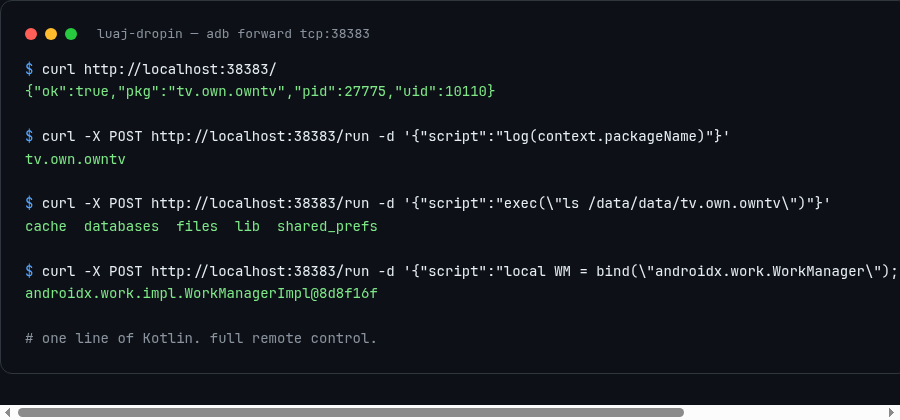

<div align="center">

# 🚀 LuaJDropIn

**One line of Kotlin. Full remote control of any Android app.**

[](LICENSE)
[](CHANGELOG.md)
[](docs/)
[](test/JavaBridgeTest.kt)
[](docs/API.md)

**Run Lua against a live Android app — over HTTP. No rebuild. No root. No Frida.**

<p align="center">
  
</p>

</div>

---

## Why?

You're debugging an app on a device. You need to:

- 🗄️ **Inspect or mutate SQLite** — without pulling the DB
- 🔑 **Read SharedPreferences** — live, while the app is running
- 🧪 **Call any Java/Kotlin API** — WorkManager, Room, your own classes
- ⚡ **Hot-reload logic** — edit a `.lua` file, it's running on-device in 250ms
- 🛠️ **Shell out** — as the app's own UID

Normally that's an APK rebuild, an Frida script, or a rooted shell. **LuaJDropIn is one line of Kotlin and a `curl`.**

## Quickstart (60 seconds)

### 1. Add the dependency

```kotlin
// app/build.gradle.kts
implementation("org.luaj:luaj-jse:3.0.1")
```

### 2. Drop in one file + one line

```kotlin
class App : Application() {
    override fun onCreate() {
        super.onCreate()
        LuaJDropIn.start(this)          // ← that's the whole integration
    }
}
```

### 3. Control it from your machine

```bash
# Is it alive?
curl http://localhost:38383/
# → {"ok":true,"pkg":"com.example.app","pid":1234,"uid":10000}

# Run Lua against the live app
curl -X POST http://localhost:38383/run \
  -H 'Content-Type: application/json' \
  -d '{"script": "log(context.packageName)"}'
# → {"ok":true,"output":"com.example.app\n"}
```

### 4. Go deeper — SQLite, live

```lua
-- read the app's own database
local SQLiteDatabase = luajava.bindClass("android.database.sqlite.SQLiteDatabase")
local db = SQLiteDatabase:openDatabase(context:getDatabasePath("app.db"):getPath(), nil, 0)
local c = db:rawQuery("SELECT COUNT(*) FROM users", nil)
c:moveToFirst()
log("users: " .. c:getLong(0))
db:close()
```

---

## What you can do

| Task | How |
|---|---|
| **Inspect SQLite** | `luajava` + `SQLiteDatabase` — read/write any table |
| **Read/Write prefs** | `context:getSharedPreferences(...)` |
| **Call app APIs** | `bind("com.your.app.SomeClass")` — every class reachable |
| **Trigger WorkManager** | `bind("androidx.work.WorkManager"):getInstance(context)` |
| **Shell out** | `exec("ls /data/data/" .. context.packageName)` |
| **Hot-reload** | `bun bin/watch.ts` — edit `.lua`, deployed on save |
| **After rebuild** | `lua/init.lua` runs automatically — state restored |

## Why it works where others don't

- **Zero dependencies** — plain `java.net.ServerSocket`. No web framework, no reflection hacks, no native code.
- **Classloader-aware bridge** — `bind("androidx.work.WorkManager")` resolves through the app's own classloader. Plain `luajava.bindClass` fails on Android daemon threads; this doesn't.
- **Force-hotpatch shim** — LuaJ ships an unreachable `getConstructor()` helper (proven by bytecode RE). `LuaJPatch` makes it work at bind time. No fork, no jar surgery.
- **Port auto-fallback** — `:38383` taken? Walks up until it finds a free port.
- **Debug-only by design** — never ship it. See the disclaimer below.

## Auto-deploy watcher

```bash
bun bin/watch.ts                # watch lua/ + src/
bun bin/watch.ts --no-source    # Lua only
```

- **Lua lane** — every `.lua` in `lua/` deploys on save (250ms debounce)
- **Source lane** — any Kotlin change → `gradle assemble` → `adb push` → `pm install -r` → relaunch
- **State restore** — a rebuild kills the Lua runtime. `lua/init.lua` runs first after every relaunch, rebuilding your state idempotently

## API

| Endpoint | Method | Body | Response |
|---|---|---|---|
| `/` | GET | — | `{"ok":true,"pkg":"...","pid":123,"uid":1000}` |
| `/status` | GET | — | same as `/` |
| `/run` | POST | `{"script":"..."}` or raw Lua | `{"ok":true,"output":"..."}` / `{"ok":false,"error":"..."}` |

Pre-bound globals: `context`, `files`, `cache`, `log(...)`, `exec(cmd)`, `bind(name)`, `new(clazz)`.

Full reference: [docs/API.md](docs/API.md) · [docs/LuaJPatch.md](docs/LuaJPatch.md)

## Examples

- [status.lua](examples/status.lua) — probe the running app
- [sqlite-inject.lua](examples/sqlite-inject.lua) — inject rows into a live Room/SQLite DB
- [dump-dex.lua](examples/dump-dex.lua) — trigger a BlackDex dump from Lua
- [prefs-lua.lua](examples/prefs-lua.lua) — read/write SharedPreferences

## Roadmap

- [x] HTTP server + Lua execution (`/status`, `/run`)
- [x] Pre-bound app context + shell escape hatch
- [x] Classloader-aware `bind()` + `new()`
- [x] Force-hotpatch shim (`LuaJPatch`)
- [x] Auto-deploy watcher with state restore
- [ ] WebSocket streaming console
- [ ] Auth token support

## ⚠️ Disclaimer (read before use)

**This tool is a remote code execution plane.** The `/run` endpoint executes
arbitrary Lua with full access to the app's process: every Java/Kotlin class,
the SQLite database, SharedPreferences, the filesystem, and `exec()` as the
app UID. Anyone with network reach to the bound port can:

- read or modify the app's data (credentials, tokens, databases)
- execute shell commands as the app's user
- trigger any app API (playback, recording, purchases, account changes)

**By using this project you acknowledge:**

1. **Debug-only.** It is designed exclusively for development, testing, and
   reverse-engineering of YOUR OWN applications and devices. It must never be
   shipped in a production build, published to a store, or left running on a
   device you do not own.
2. **No warranty.** The software is provided "AS IS", without warranty of any
   kind. The author is not liable for any damage, data loss, or misuse.
3. **Your responsibility.** You are solely responsible for how this tool is
   used and for securing the endpoint (firewall, adb reverse only, no public
   exposure). Exposing `:38383` to an untrusted network is equivalent to
   publishing a root shell on that port.
4. **No circumvention endorsement.** Nothing here is intended to bypass DRM,
   licensing, or access controls on content or services you do not own. Use
   against your own hardware and accounts only.

This disclaimer mirrors the practice of similar tooling (Shizuku/rish, Frida,
Objection): the capability is neutral, the deployment is yours.

## Contributing

Contributions are what make the open-source community such an amazing place — read [CONTRIBUTING.md](CONTRIBUTING.md) and jump in.

## License

Distributed under the MIT License. See [LICENSE](LICENSE) for more information.

## Contact & Acknowledgments

Maintainer: @toxicwind — open a [discussion](https://github.com/toxicwind/luaj-dropin/discussions) or [file an issue](https://github.com/toxicwind/luaj-dropin/issues).

**Credits:**

- **[LuaJ](https://github.com/luaj/luaj)** (MIT) — the pure-Java Lua 5.2 VM + `luajava` bridge this project rides on. No fork: the force-hotpatch shim works around a genuine gap in the stock library (see [docs/LuaJPatch.md](docs/LuaJPatch.md)).
- **[Fengari](https://github.com/fengari-lua/fengari)** (MIT) — the JS Lua VM whose protocol insights informed the drop-in's design.
- **Shizuku / rish, Frida, Objection** — the tooling whose disclaimer practice this project mirrors.

---

> Don't forget to give the project a star! ⭐ Thanks again!