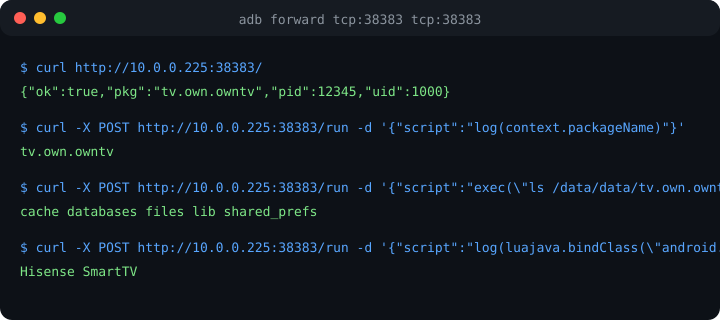

# LuaJDropIn

<div align="center">

[](LICENSE)
[](CHANGELOG.md)
[](docs/)
[](docs/API.md)

</div>

## One line of Kotlin. Full remote control of any Android app.

**LuaJDropIn** embeds a zero-dependency HTTP + LuaJ runtime into any Android app. One line of Kotlin, one port, full remote control: run Lua scripts over HTTP against live app state — SQLite, SharedPreferences, classloaders, and any Java/Kotlin API via `luajava`.

<p align="center">
  
</p>

## Quickstart

### 1. Add the dependency

```kotlin
// app/build.gradle.kts
implementation("org.luaj:luaj-jse:3.0.1")
```

### 2. Copy one file

Drop `src/net/luaj/dropin/LuaJDropIn.kt` into your module.

### 3. Start it in Application.onCreate

```kotlin
class App : Application() {
    override fun onCreate() {
        super.onCreate()
        LuaJDropIn.start(this)          // binds :38383 (auto-increments if busy)
    }
}
```

### 4. Control it over HTTP

```bash
# Status probe
curl http://localhost:38383/

# Run any Lua script against the live app
curl -X POST http://localhost:38383/run \
  -H 'Content-Type: application/json' \
  -d '{"script": "log(context.packageName)"}'

# → {"ok":true,"output":"tv.own.owntv\n"}
```

## Features

- **Zero dependencies** — plain `java.net.ServerSocket`, no web framework, no reflection hacks.
- **Full LuaJ JSE platform** — `luajava.bindClass`, `CoerceJavaToLua`, coroutines, io, os.
- **Classloader-aware Java bridge** — `bind("androidx.work.WorkManager")` resolves through the app's own classloader, so AndroidX + app classes work from Lua (plain `luajava.bindClass` fails on Android daemon threads). Implemented in `JavaBridge.kt` — a pure-JVM core with a **TDD suite** (`test/JavaBridgeTest.kt`, 9 tests, `./gradlew test`): bind through loader, no-arg/string/class ctors, inner `Builder` classes, nil-not-throw on missing class/ctor, method chaining.
- **Force-hotpatch shim (`LuaJPatch`)** — stock LuaJ has an unreachable `getConstructor()` helper (proven by bytecode RE). The vendored shim patches the JavaClass methods map at bind time so `Builder["getConstructor"](args)` works alongside native `Class.new(args)`. No fork, no jar surgery. See [docs/LuaJPatch.md](docs/LuaJPatch.md).
- **Reliable construction** — `new(clazz)` helper instantiates classes including inner classes (`Data$Builder`).
- **Live app context** — `context`, `files`, `cache` globals pre-bound to the running app.
- **Shell escape hatch** — `exec(cmd)` for anything Lua can't reach.
- **Console capture** — `log(...)` streams back to the HTTP response.
- **Port auto-fallback** — binds `:38383`, walks up if taken.
- **Custom globals** — `configureGlobals { ... }` to inject your own APIs.
- **Auto-deploy watcher** — `bin/watch.ts` watches `lua/` + `src/`: Lua changes POST instantly, Kotlin changes rebuild + redeploy the APK, and **state restore** re-runs `lua/init.lua` after every relaunch.

## API

| Endpoint | Method | Body | Response |
|---|---|---|---|
| `/` | GET | — | `{"ok":true,"pkg":"...","pid":123,"uid":1000}` |
| `/status` | GET | — | same as `/` |
| `/run` | POST | `{"script":"..."}` or raw Lua | `{"ok":true,"output":"..."}` / `{"ok":false,"error":"..."}` |

Pre-bound globals: `context`, `files`, `cache`, `log(...)`, `exec(cmd)`, `bind(name)`, `new(clazz)`.

## Auto-deploy watcher

```bash
bun bin/watch.ts                # watch lua/ + src/ (defaults)
bun bin/watch.ts --no-source    # Lua only
bun bin/watch.ts --no-lua       # source only
bun bin/watch.ts --lua-dir lua --host http://127.0.0.1:38383
```

- **Lua lane**: every `.lua` in `lua/` deploys on save (250ms debounce). Files starting with `_` are skipped.
- **Source lane**: any `.kt/.java/.xml/.kts` change → `gradle assembleStandardDebug` → `adb push` → `pm install -r` → relaunch (1.5s debounce).
- **State restore**: a rebuild kills the Lua runtime state. `lua/init.lua` runs first at watch start AND after every relaunch — write it idempotently (dedupe profiles, insert missing sources, re-link). Then the remaining `.lua` files run in order.

## Examples

See [examples/](examples/) for runnable scripts:

- [status.lua](examples/status.lua) — probe the running app
- [sqlite-inject.lua](examples/sqlite-inject.lua) — inject rows into a live Room/SQLite DB
- [dump-dex.lua](examples/dump-dex.lua) — trigger a BlackDex dump from Lua
- [prefs-lua.lua](examples/prefs-lua.lua) — read/write SharedPreferences

## Roadmap

- [x] HTTP server + Lua execution (`/status`, `/run`)
- [x] Pre-bound app context + shell escape hatch
- [x] Classloader-aware `bind()` + `new()` (AndroidX/app classes reachable)
- [x] Auto-deploy watcher with state restore (`bin/watch.ts` + `lua/init.lua`)
- [ ] WebSocket streaming console
- [ ] Auth token support

## ⚠️ Disclaimer (read before use)

**This tool is a remote code execution plane.** The `/run` endpoint executes
arbitrary Lua with full access to the app's process: every Java/Kotlin class,
the SQLite database, SharedPreferences, the filesystem, and `exec()` as the
app UID. Anyone with network reach to the bound port can:

- read or modify the app's data (credentials, tokens, databases)
- execute shell commands as the app's user
- trigger any app API (playback, recording, purchases, account changes)

**By using this project you acknowledge:**

1. **Debug-only.** It is designed exclusively for development, testing, and
   reverse-engineering of YOUR OWN applications and devices. It must never be
   shipped in a production build, published to a store, or left running on a
   device you do not own.
2. **No warranty.** The software is provided "AS IS", without warranty of any
   kind. The author is not liable for any damage, data loss, or misuse.
3. **Your responsibility.** You are solely responsible for how this tool is
   used and for securing the endpoint (firewall, adb reverse only, no public
   exposure). Exposing `:38383` to an untrusted network is equivalent to
   publishing a root shell on that port.
4. **No circumvention endorsement.** Nothing here is intended to bypass DRM,
   licensing, or access controls on content or services you do not own. Use
   against your own hardware and accounts only.

This disclaimer mirrors the practice of similar tooling (Shizuku/rish, Frida,
Objection): the capability is neutral, the deployment is yours.

## Contributing

Contributions are what make the open-source community such an amazing place — read [CONTRIBUTING.md](CONTRIBUTING.md) and jump in.

## License

Distributed under the MIT License. See [LICENSE](LICENSE) for more information.

## Contact & Acknowledgments

Maintainer: @toxicwind — open a [discussion](https://github.com/toxicwind/android-fleet/discussions).

---

> Don't forget to give the project a star! ⭐ Thanks again!
